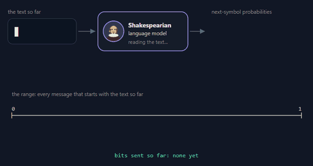
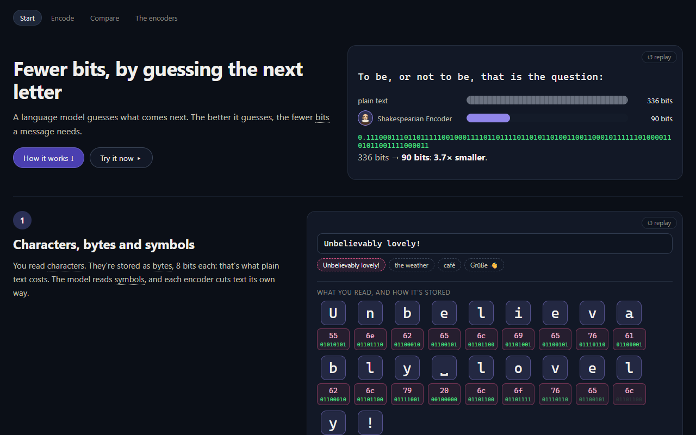
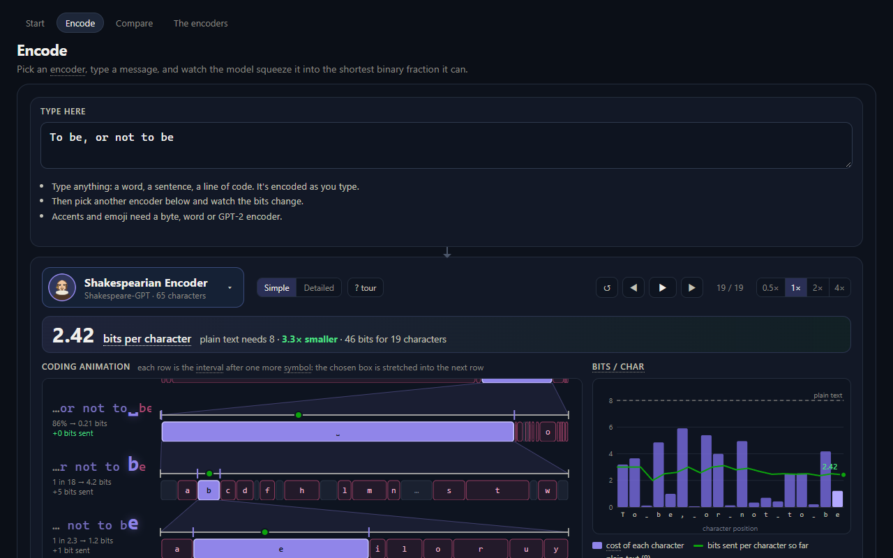
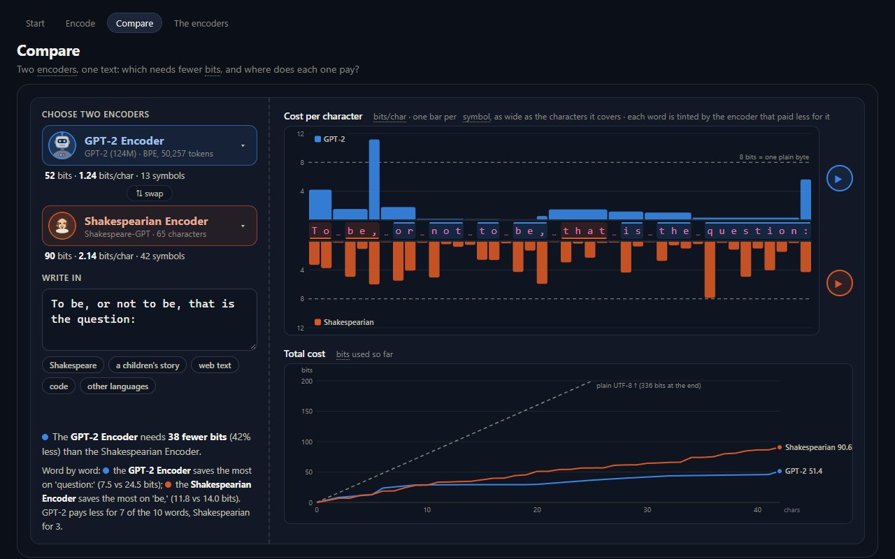
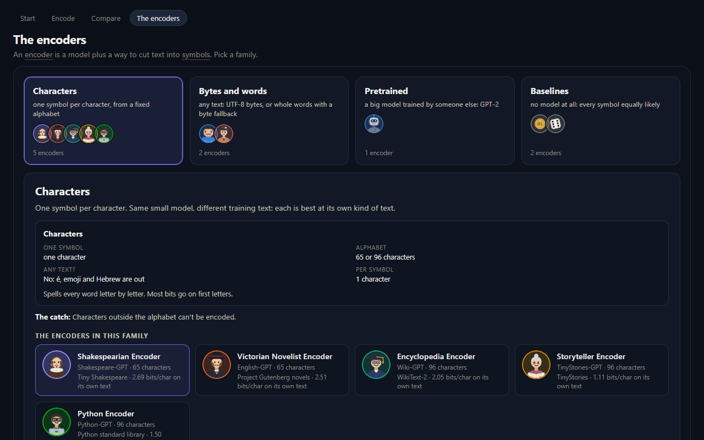

# Fewer bits, by guessing the next letter

**Arithmetic coding with language models, step by step.** A model guesses each next letter; the better
it guesses, the fewer bits the message needs. A 0.8M-parameter Shakespeare model sends
*“To be, or not to be, that is the question:”* in 90 bits instead of 336; GPT-2 needs 52.

**▶ Live demo: https://galashk-arithmetic-coder.hf.space** (works on phones too, and can be added to
the home screen)



| Start: characters, symbols, bits | Encode: watch every symbol shrink the range |
|---|---|
|  |  |
| **Compare: two encoders, per character** | **The encoders: four families, ten models** |
|  |  |

What's inside:

- **An exact arithmetic coder:** integer arithmetic, no floating-point drift. A test checks that
  every encoding decodes back to the same text.
- **Ten encoders in four families:**
  - character models trained on plays, novels, Wikipedia, children's stories and Python
  - byte and word models trained on web text
  - OpenAI's GPT-2, loaded into our own nanoGPT code with our own byte-pair-encoding tokenizer
    (no `transformers` dependency)
  - two no-model baselines
- **A web showcase** (FastAPI + plain JS, no build step), with an animated explainer, a coding
  ladder, a receiver that decodes the bits, a 1-v-1 comparison and a guided tour.
- **Five studies** comparing the models: [studies/](studies/). Plain-language background:
  [what a character, a symbol and a bit are](deliberates/model_families.md).
- **A peer-to-peer CLI chat** that sends messages as arithmetic-coded bits, with a key-derived
  permutation.

## Setup

```
uv sync --all-groups
```

Or run the whole showcase, GPT-2 included, in a container: `docker build -t arithmetic-coder .`, then
`docker run -p 7860:7860 arithmetic-coder` and open http://localhost:7860. The live demo is the same
image, built on Hugging Face Spaces from a release tag: see [deploy/](deploy/) and
[deliberates/deploy_plan.md](deliberates/deploy_plan.md).

## Run

| what | command |
|---|---|
| Encoder showcase: an animated start page (characters, symbols, bits), then encode, compare two encoders, meet the families | `uv run arith-demo`, then open http://127.0.0.1:8000 |
| Chat relay (forwards messages, never sees text or keys) | `uv run arith-relay` |
| Command-line chat client | `uv run arith-chat --user alice`, then `/add bob shakespeare_char <key>` |
| Tests | `uv run pytest` |
| Model comparison study | `uv run --group studies python studies/01_compare_models/compare_models.py` |
| Every model on every kind of text | `uv run --group studies python studies/02_model_bank/compare_bank.py` |
| How the models differ (char classes, free chars, overconfidence) | `uv run --group studies python studies/03_model_differences/compare_models.py` |
| Bits per character along a message | `uv run --group studies python studies/04_bits_along_string/along_string.py` |
| Characters vs bytes vs words vs GPT-2 | `uv run --group studies python studies/05_tokenizations/compare_tokenizations.py` |

## Layout

```
src/arithmetic_coder/   backend (Python package)
  coding/               exact arithmetic coder, key-derived permutation, encoding trace
  models/               model wrappers, vendored nanoGPT definition, model registry
  p2p/                  peer sessions, wire protocol, relay server, CLI client
  api/                  FastAPI backend for the showcase: /api/models, /api/encode, /api/decode, /api/tokenize (JSON only)
frontend/               showcase UI, four pages (index = start, encode, compare, encoders): HTML, CSS, JS modules (no build step, no CDN), installable (PWA)
deploy/                 the Hugging Face Space's Dockerfile and README (built from a GitHub tag)
model_bank/             models only: <id>/{ckpt.pt, meta.pkl, model.json, train.log}
training/               separate uv project (CUDA torch): corpora, training recipes, tests
studies/                experiments and their results
tests/                  pytest suite
```

## Models

Every folder in `model_bank/` with `ckpt.pt`, `model.json` and its tokenizer's files is a model. The
built-in uniform baselines need no files: `uniform` (the 65 Shakespeare characters), `uniform_ascii`
(96 printable ASCII characters) and `uniform_bytes` (256 bytes, any text).

`model.json` example:

```json
{ "name": "Shakespeare-GPT", "description": "0.8M-param char-level nanoGPT trained on Tiny Shakespeare", "kind": "nanogpt" }
```

Optional fields feed the showcase's encoders page: `"dataset"` (`name`, `about`, `url`, `chars`), `"examples"`
(typical sentences in the style it was trained on) and `"training"` (`params`, `block_size`, `val_bits_per_char`).
`training/train.py` writes all three from its recipes. `"showcase": false` keeps a model out of the
showcase's lists (it still works by id, and the studies use it): `web_small`, `wiki_bytes` and the
65-character `uniform` are hidden because another encoder already covers each one. How the families
differ, and what a symbol, a character and a bit are: [deliberates/model_families.md](deliberates/model_families.md).

### Tokenizers

Each model brings its own tokenizer (`"tokenizer": {"kind": ...}` in `model.json`, default `char`).
The coder works on its symbols, and sizes are still compared in bits per *character*.

| kind | symbols | files | any text? |
|---|---|---|---|
| `char` | one per character of a fixed vocabulary | `meta.pkl` | no: only the vocabulary's characters |
| `bytes` | the 256 UTF-8 bytes | - | yes |
| `words` | 256 bytes + a list of whole words (unknown words are spelled out in bytes) | `words.json` | yes |
| `gpt2` | GPT-2's 50,257-token byte-level BPE (our own encoder) | `vocab.json`, `merges.txt` | yes |

Big vocabularies get more coder precision automatically (16 bits up to 256 symbols, then log2(vocab) + 10:
23 for words, 26 for GPT-2), so every symbol's minimum count stays a tiny fraction of the range.

### GPT-2 (pretrained, 124M params)

```
uv run --project training python training/fetch_gpt2.py
```

This downloads OpenAI's GPT-2 small (~550 MB, MIT licence) from Hugging Face and maps it onto the
nanoGPT model code already in the package, so no `transformers` dependency is needed. It writes
`model_bank/gpt2/`, whose `ckpt.pt` (498 MB) is git-ignored. On CPU it encodes or decodes about 15
tokens per second, so a short chat message takes 1–2 s each way. Its context is capped at 256 tokens.

### Training models (GPU)

Training lives in `training/`, a separate uv project whose torch is a CUDA build. The app itself
stays on CPU torch, so peers keep getting identical probabilities. The GPU needs an NVIDIA driver
that supports CUDA 13.2.

```
uv sync --project training                                        # once
uv run --project training python training/train.py --list         # recipes
uv run --project training python training/train.py wiki_small     # train one (or several)
uv run --project training pytest training/tests                   # corpus-cleaning tests
```

Each recipe is a corpus, a vocabulary, a size and a training budget (see `RECIPES` in
`training/train.py`). Corpora are downloaded once into `training/_downloads/`:

| recipe | corpus | vocab | size |
|---|---|---|---|
| `shakespeare_char`, `english_char` | Tiny Shakespeare, Gutenberg novels | 65 chars | tiny (0.8M) |
| `wiki_small` | WikiText-2 (Wikipedia) | ASCII (96) | small (3.2M) |
| `stories_small` | TinyStories (simple English) | ASCII (96) | small (3.2M) |
| `web_small` | C4 (web text) | ASCII (96) | small (3.2M) |
| `python_small` | Python standard library source | ASCII (96) | small (3.2M) |
| `web_bytes`, `wiki_bytes` | C4 / WikiText with Unicode kept | UTF-8 bytes (256) | small |
| `web_words` | C4 with Unicode kept | 4,096 words + 256 bytes | small (+1M embedding) |

### Importing models trained elsewhere

```
uv run arith-import-model path/to/ckpt.pt --id my_model --name "My-GPT" --description "..." --meta path/to/meta.pkl
```

This works with any char-level nanoGPT checkpoint; use `--vocab ascii` instead of `--meta` if it was
trained on the ASCII vocabulary. The command keeps only the weights, writes `model.json`, and checks
that the model loads.

## Notes

- **Peers must get bit-identical probabilities.** A single difference in a rounded count breaks decoding,
  and the fingerprint doesn't detect it. Three things can cause one:
  - **The torch version.** `uv.lock` pins it, so peers who install with `uv sync` match.
  - **The number of CPU threads.** Inference always uses 4 threads, and a test checks that 1 and 4
    threads give identical counts.
  - **The CPU's vector instructions,** which can differ between machines. This risk remains, and it
    grows with bigger models and higher precision.
- **This is a POC, not secure messaging.** The key permutation only hides the encoding, keys are
  stored in plain text, and the relay has no authentication.


## Credits

- **GPT-2:** OpenAI, MIT licence ([openai-community/gpt2](https://huggingface.co/openai-community/gpt2)).
- **nanoGPT model code:** Andrej Karpathy, MIT licence (vendored in `src/arithmetic_coder/models/nanogpt.py`).
- **Training text**, each under its own terms:
  - [Tiny Shakespeare](https://github.com/karpathy/char-rnn) and [Project Gutenberg](https://www.gutenberg.org) novels: public domain texts
  - [WikiText-2](https://huggingface.co/datasets/Salesforce/wikitext): CC BY-SA
  - [TinyStories](https://huggingface.co/datasets/roneneldan/TinyStories): CDLA-Sharing-1.0
  - [C4](https://huggingface.co/datasets/allenai/c4): ODC-BY
  - the Python standard library's source: PSF licence
