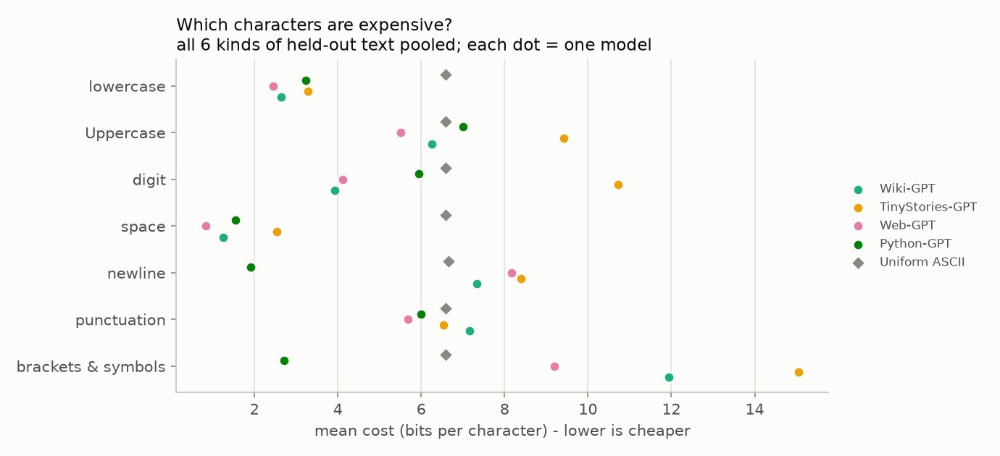
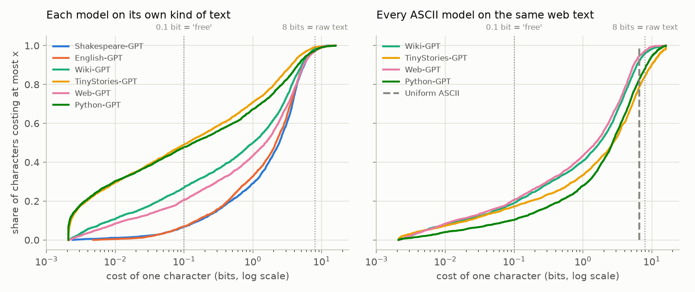
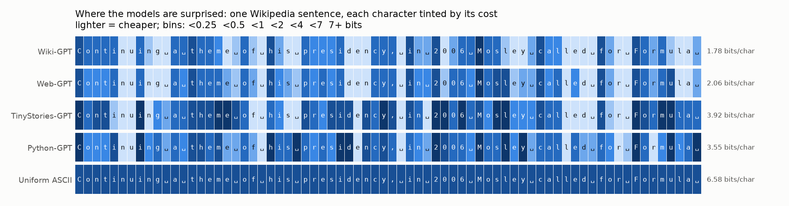
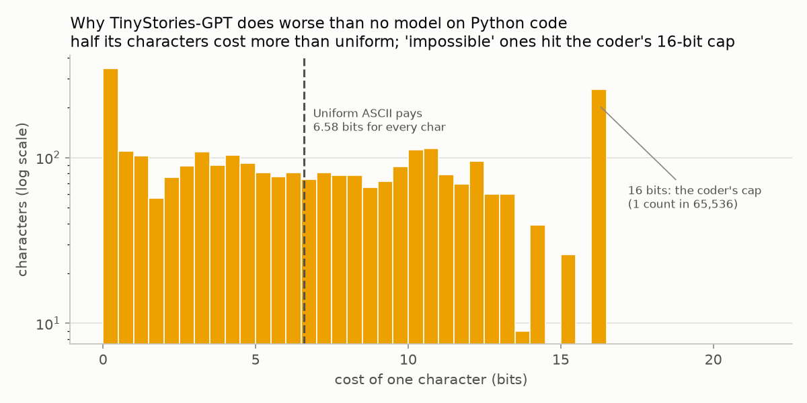

# Study 03: how the models differ

Every model costed character by character on the same held-out text: 6 kinds of text × 12 snippets
× 250 characters, from the validation splits no model was trained on. Costs come from the real coder:
for each character, the probability it actually used (ideal cost −log2 p) and the bits the payload
actually grew by. Raw numbers are in [results/stats.md](results/stats.md); the code is
`compare_models.py`.

**Accuracy check:** the real payload is never more than 1 bit above the sum of ideal costs, and on
average it's 0.9 bits *below*. The final interval sometimes happens to contain a short binary
fraction. So per-character costs are a faithful breakdown of the real message size.

## 1. Each model has its own "cheap" and "expensive" characters

| bits/char (all text pooled) | Wiki-GPT | TinyStories-GPT | Web-GPT | Python-GPT | Uniform |
|---|---:|---:|---:|---:|---:|
| space | 1.25 | 2.54 | **0.84** | 1.54 | 6.58 |
| digit | **3.92** | 10.73 | 4.13 | 5.94 | 6.58 |
| newline | 7.33 | 8.39 | 8.17 | **1.92** | 6.65 |
| brackets & symbols | 11.93 | 15.06 | 9.20 | **2.72** | 6.58 |

- **Code characters:** Python-GPT is the only model that finds brackets, symbols and newlines cheap.
  For the prose models these are *more* expensive than for the uniform model: up to 15 bits for
  TinyStories-GPT. A model pays dearly for characters it has learned to treat as "almost
  impossible".
- **Digits:** TinyStories-GPT has almost never seen a digit (10.7 bits each). Wiki-GPT, trained on
  dates and statistics, pays only 3.9.
- **Plain prose:** Web-GPT, the generalist, is cheapest on everyday text: lowercase letters, spaces
  and capitals.

## 2. Some models make half of all characters nearly free

| on its own text | median cost | "free" (< 0.1 bit) | costliest 10% of chars carry |
|---|---:|---:|---:|
| TinyStories-GPT | 0.11 bits | **49%** | 52% of all bits |
| Python-GPT | 0.14 bits | **48%** | 50% |
| Wiki-GPT | 1.00 bits | 27% | 35% |
| Web-GPT | 1.53 bits | 21% | 32% |
| Shakespeare-GPT | 2.42 bits | 7% | 26% |

- **Predictable text is almost free:** simple stories and code are so predictable that half their
  characters cost under a tenth of a bit, and the payload is dominated by a few surprising
  characters. Shakespeare is the opposite: almost no free characters, and the cost is spread evenly.
- **The coder's own limits are visible:** no curve starts below about 0.002 bits, and nothing costs
  more than 16 bits. Both are effects of the 16-bit probability rounding (more in section 4).

## 3. Where the models disagree, character by character

- **One Wikipedia sentence** costs 1.78 bits/char with Wiki-GPT, 2.06 with Web-GPT, 3.55 with
  Python-GPT and 3.92 with TinyStories-GPT.
- **Everyone pays for the same few characters:** the year "2006" and the name "Mosley".
- **TinyStories-GPT is also surprised by an ordinary word:** "presidency" is not a children's-story
  word.
- **Word endings and spaces** are light (cheap) for every trained model.

## 4. A confident wrong model is worse than no model

On Python code, TinyStories-GPT spends 7.01 bits per character, more than the uniform model's 6.58:
- **Half the characters cost more than uniform:** 50% of characters cost more than 6.58 bits, and
  they carry 81% of all its bits.
- **The 16-bit cap:** about 250 characters hit exactly 16 bits. That isn't the model, it's the coder.
  Every character gets at least 1 count out of 65,536, so 16 bits is the maximum possible cost.
  Without that floor these characters would cost far more, and a model that gives a character zero
  probability couldn't encode it at all.
- **Worst character:** 16 bits for the "." in `from .` (a relative import). No children's story has
  ever put a full stop there.

**Consequence for the app:** `precision_bits` is a safety setting. Higher precision lets a confident
model spend less on likely characters, but it raises the cap on what a wrong guess can cost.

## 5. Which models "think alike"

Rank correlation of per-character cost on the same text:

| | Wiki-GPT | TinyStories-GPT | Web-GPT | Python-GPT |
|---|---:|---:|---:|---:|
| Wiki-GPT | 1 | 0.65 | **0.89** | 0.52 |
| TinyStories-GPT | | 1 | 0.66 | **0.34** |
| Web-GPT | | | 1 | 0.58 |

- **Wiki-GPT and Web-GPT** find the same characters hard (0.89). Both learned general written English.
- **Python-GPT and TinyStories-GPT** disagree the most (0.34). They learned the most different
  "languages".
