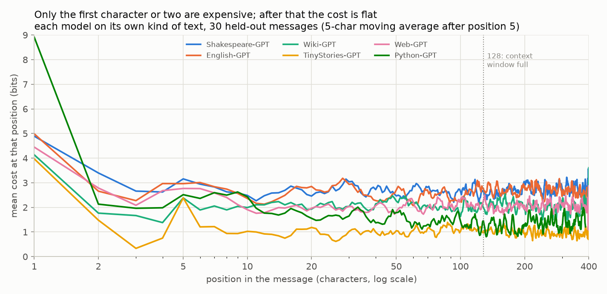
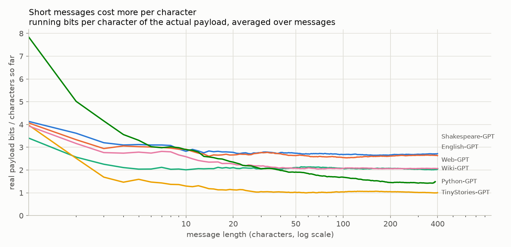
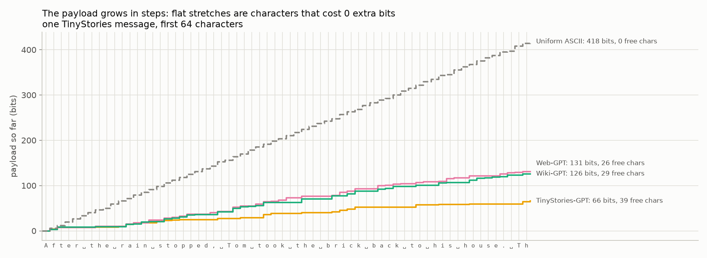
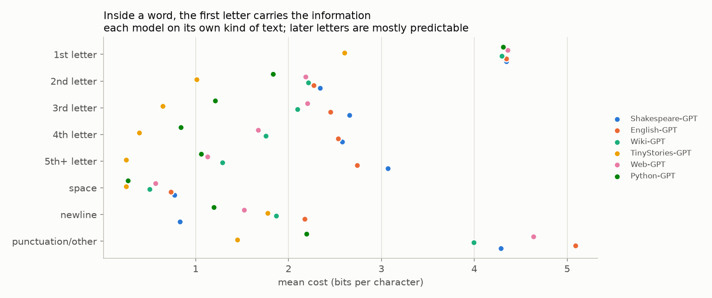

# Study 04: how the cost per character changes along a message

30 held-out messages of 400 characters per kind of text. Each model is measured on its own kind of
text, and Web-GPT on every kind. Costs come from the real coder (see study 03). Raw numbers are in
[results/stats.md](results/stats.md); the code is `along_string.py`.

## 1. Only the first character or two are expensive

- **First character:** 4–5 bits for the prose models; at that point the model has seen nothing
  except the start-of-message symbol.
- **Python-GPT's first character costs 8.9 bits:** the messages start somewhere in the middle of a
  file, which is genuinely unpredictable.
- **From the 2nd–3rd character on:** the cost settles at each model's typical level and stays there.
- **No change at 128 characters,** where the model's context window fills and the oldest characters
  start dropping out. For prose, the useful context is much shorter than 128 characters.

## 2. Short messages cost more per character

| real bits/char of a message of... | 10 chars | 20 | 50 | 100 | 400 |
|---|---:|---:|---:|---:|---:|
| Web-GPT (web text) | 2.59 | 2.27 | 2.08 | 2.08 | 2.07 |
| TinyStories-GPT | 1.30 | 1.13 | 1.02 | 1.04 | 1.01 |
| Python-GPT (code) | 2.90 | 2.35 | 1.91 | 1.69 | 1.49 |
| Wiki-GPT | 2.01 | 2.10 | 2.11 | 2.07 | 2.06 |

- **The start-up cost is a fixed overhead:** for a 10-character chat message it adds about 25%
  (Web-GPT 2.59 vs 2.07). By 50 characters it's gone.
- **Code keeps improving with more context:** Python-GPT's cost *halves* between 10 and 200
  characters, because indentation, variable names and repeated structure become predictable. Prose
  plateaus after about 20–50 characters.
- **Wiki-GPT is flat from the start:** Wikipedia lines are short and self-contained (titles, list
  items), so there's little to gain from context.

## 3. The payload grows in steps

The first 64 characters of one story:

| model | payload | characters that added 0 bits |
|---|---:|---:|
| TinyStories-GPT | 66 bits | **39 of 64** |
| Wiki-GPT | 126 bits | 29 |
| Web-GPT | 131 bits | 26 |
| Uniform ASCII | 418 bits | 0 |

- **Free characters:** with the matching model, 6 out of 10 characters don't change the payload at
  all. This is the "+0 bits" pill in the web demo.
- **Where the bits go:** they're spent in a few jumps, at the start of new words and names.

## 4. Inside a word, the first letter carries the information

| | 1st letter | 2nd | 3rd | 5th+ | space | 1st letters: share of chars → share of bits |
|---|---:|---:|---:|---:|---:|---:|
| Web-GPT | 4.36 | 2.18 | 2.21 | 1.13 | 0.57 | 17% → **36%** |
| Wiki-GPT | 4.29 | 2.21 | 2.10 | 1.29 | 0.51 | 16% → 34% |
| TinyStories-GPT | 2.60 | 1.01 | 0.65 | 0.25 | 0.25 | 20% → **52%** |
| Python-GPT | 4.31 | 1.83 | 1.21 | 1.06 | 0.27 | 12% → 35% |

- **Word beginnings are where the information is:** once a model has seen how a word begins, the
  rest of the word is mostly predictable. The first letter of each word is a sixth of all characters
  but costs a third to a half of all bits.
- **Spaces** are almost free.
- **The two small 65-character models** (Shakespeare-GPT and English-GPT) also pay 2.7–3.1 bits for
  late letters. They're too small to complete long words reliably, which is a capacity limit.

**This points to the next step:** a model that predicts whole words or subwords would pay the
"first letter" price once per word, not once per character. That's the motivation for the
tokenization plan.
