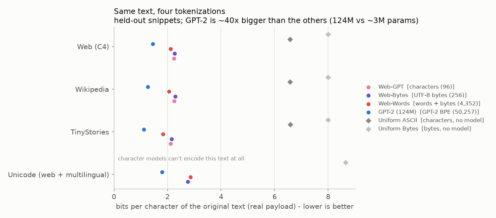
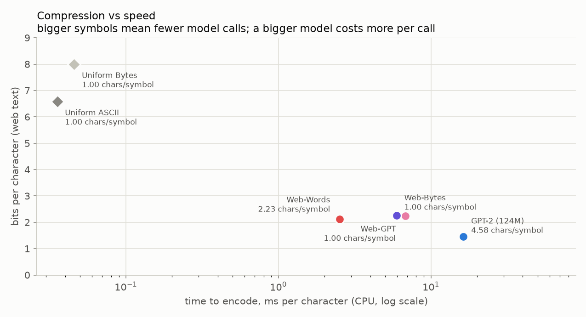
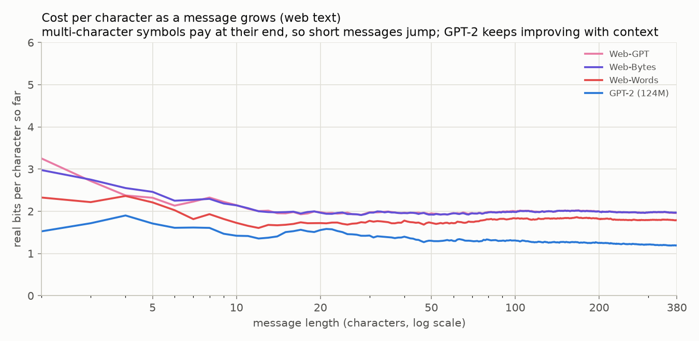
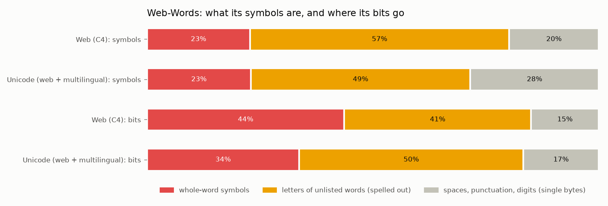

# Study 05: characters vs bytes vs words vs GPT-2

The same held-out text was encoded with four tokenizations. Every number is the **real payload in
bits per character of the original text**, so tokenizations with different symbol sizes compare
fairly. Raw numbers are in [results/stats.md](results/stats.md); the code is
`compare_tokenizations.py`.

| model | tokenizer | params | trained on |
|---|---|---:|---|
| Web-GPT | characters (96) | 3.2M | C4, ASCII only |
| Web-Bytes | UTF-8 bytes (256) | 3.2M | C4, Unicode kept |
| Web-Words | 4,096 words + 256 bytes | 3.2M + 1.1M embeddings | C4, Unicode kept |
| GPT-2 | BPE (50,257) | 124M | OpenAI's WebText |

All three of our models have the same core and the same training budget, so they differ only in
tokenization. GPT-2 is about 40× bigger and was trained on far more text: it shows what a large
pretrained model buys, not a like-for-like tokenizer comparison.

## 1. Compression on the same text

| bits/char | Web (C4) | Wikipedia | TinyStories | Unicode text |
|---|---:|---:|---:|---:|
| Web-GPT (characters) | 2.24 | 2.26 | 2.12 | **can't encode** |
| Web-Bytes | 2.26 | 2.29 | 2.15 | 2.76 |
| Web-Words | 2.11 | 2.06 | 1.83 | 2.86 |
| GPT-2 | **1.46** | **1.26** | **1.11** | **1.80** |
| Uniform Bytes (no model) | 8.00 | 8.00 | 8.00 | 8.65 |

- **Bytes cost nothing extra on English and can encode any text.**
  - Web-Bytes matches the character model within 0.03 bits per character on all three English texts.
  - Its 160 extra symbols that never occur in English are learned as impossible and cost nothing.
  - It encodes accents, Hebrew and emoji at 2.76 bits per character, where the character model
    can't send them at all. Non-ASCII characters take 2–4 bytes, which is why even Uniform Bytes
    pays more than 8 bits per character on that text.
- **Whole-word symbols beat characters by 6–14%.**
  - The core network is the same size; only the symbols changed.
  - The biggest gain is on simple, repetitive text (TinyStories, 1.83 vs 2.12), where most words
    are in the word list.
- **GPT-2 needs 35–48% fewer bits than our models on English.**
  - That's 1.11–1.46 bits per character, and 1.80 even on mixed Unicode text.
  - Its advantages are scale and pretraining (124M parameters, trained on far more text) plus
    whole-word tokens.

## 2. Bigger symbols are faster

| encode on CPU | ms per character | characters per symbol |
|---|---:|---:|
| Web-GPT / Web-Bytes | 5.8 / 5.6 | 1.00 |
| Web-Words | **2.4** | 2.23 |
| GPT-2 | 15.4 | 4.58 |

- **The coder calls the model once per *symbol*.** Web-Words makes 2.2× fewer calls than the
  character model, so it's both better *and* 2.4× faster.
- **GPT-2 makes 4.6× fewer calls,** but each call is about 13× more expensive. Overall it's 2.7×
  slower than the character models, about 1–2 seconds per chat message each way. That's still usable.

## 3. Cost as a message grows

| real bits/char of a web message of... | 10 chars | 50 | 100 | 380 |
|---|---:|---:|---:|---:|
| Web-GPT | 2.15 | 1.95 | 2.00 | 1.96 |
| Web-Words | 1.73 | 1.73 | 1.83 | 1.79 |
| GPT-2 | 1.42 | 1.30 | 1.31 | **1.19** |

- **The small models plateau within about 50 characters** (study 04 found the same).
- **GPT-2 keeps getting cheaper** all the way to the end of the message: its context is 256 tokens,
  more than 1,000 characters, and it has the capacity to use it.
- **Short messages:** Web-Words and GPT-2 avoid most of the start-up cost of short messages.

## 4. Where Web-Words' bits go

| web text | share of symbols | share of bits |
|---|---:|---:|
| whole-word symbols | 23% | 44% |
| letters of words not in the list (spelled out byte by byte) | **57%** | **41%** |
| spaces, punctuation, digits | 20% | 15% |

- **Most symbols are spelled-out letters.** Web text has a long tail of names and rare words, and
  4,096 words don't cover it. The letters of unlisted words are 57% of all symbols and 41% of all
  bits.
- **The fix is subwords:** BPE splits rare words into a few frequent pieces instead of single bytes.
  That's the one tokenization this round left out, and this chart is the strongest argument for
  adding it.

## Takeaways for the app

1. **Bytes should replace characters as the default small tokenization:** same compression, and no
   more "not in vocabulary" errors.
2. **GPT-2 is the best model when 1–2 seconds per message is acceptable.**
3. **Words help, but subword BPE is the obvious next step:** it would keep the speed of big symbols
   without spelling out a third of the text.
4. **Determinism holds:** for every new model, 1 and 4 CPU threads give identical counts (tested),
   and GPT-2's 26-bit precision works without problems.
